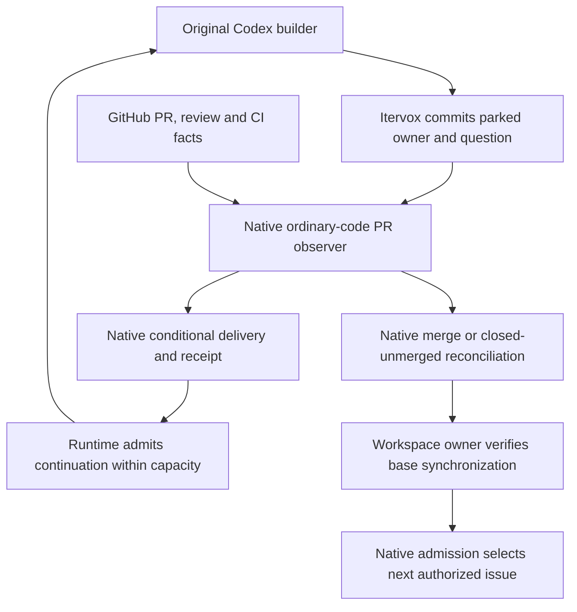

# Local proposal: native PR observation and retained-builder delivery

Draft date: 2026-10-20. Baseline:
[Itervox v0.2.1](https://github.com/vnovick/itervox/releases/tag/v0.2.1), source
[`cb09d4bf1711f86479b47e4d9c665df07045ac88`](https://github.com/vnovick/itervox/tree/cb09d4bf1711f86479b47e4d9c665df07045ac88).
This is a local design proposal for maintainer discussion. It has not been
submitted upstream. No fork, runtime implementation, deployment or pilot is
authorized by this document. Itervox remains a candidate, not a qualified or
selected runtime. See the [comparison](runtime-research.md).

## Problem and worked case

A builder opens a PR, completes local checks and parks for review. A human or CI
then reports a defect. The runtime must deliver that evidence to the original
builder, preserve the issue claim, and let the builder repair the PR. It must wait
without model inference. After human merge, the runtime must reconcile the issue
and refresh the base before admitting the next serial issue.

Today, a callback sent from `after_run` can precede parking. A 202 response from
`provide_input` proves enqueue only. The event loop can drop an early message or
apply it to a later question for the same issue. A lost HTTP response can also
leave the sender unable to distinguish rejection from consumption. These are
delivery-contract gaps, not prompt-writing problems. The decisive sources are
the tagged [worker](https://github.com/vnovick/itervox/blob/v0.2.1/internal/orchestrator/worker.go),
[input operation](https://github.com/vnovick/itervox/blob/v0.2.1/internal/orchestrator/issue_control.go#L273-L295),
[handler](https://github.com/vnovick/itervox/blob/v0.2.1/internal/server/handlers.go#L816-L834)
and [event loop](https://github.com/vnovick/itervox/blob/v0.2.1/internal/orchestrator/event_loop.go).

The native `input_required` helper path is real, but launches a model run. It
does not supply the proposed ordinary-code lifecycle or conditional consumption
receipt. `pr_opened` excludes input-required exits. The existing
[`pr_merged` automation dispatcher](https://github.com/vnovick/itervox/blob/v0.2.1/internal/orchestrator/automation_pr_merged_dispatch.go)
does not establish observation of external human merges.

## Ownership and flow

Itervox must own the observation job, durable identities, input admission,
capacity, recovery and GitHub lifecycle. Its existing event loop remains the
state-mutation owner. Its workspace owner remains responsible for Git operations.
OPL supplies project setup and policy guidance only. There is no OPL watcher,
callback service, session ledger or scheduler.

The observer reads facts and computes semantic changes in ordinary code. The
builder reasons about actionable defects and repairs. A timer tick, unchanged
head, full pool or pending check is not a reason to launch a model. A changed
dependency-analysis input can still invoke existing inference where configured;
this proposal does not claim that every runtime operation is inference-free.

## Proposed contracts

The terms below describe minimum semantics, not existing API names, endpoint
paths, configuration syntax or an agreed upstream schema. Maintainers must choose
the concrete interface and persistence representation.

### 1. Observation starts from durable parking

After the event loop commits an identifiable pending question and saved builder
session, it may register an ordinary-code observation job. The job records the
project, issue, builder run/session, pending-question generation, repository/PR,
current head, observation cursor and cancellation generation. It starts only
after that owner exists. Repeated registration for that same owner returns the
existing job rather than starting a second observer.

The runtime supervises the job using its existing lifecycle and capacity owner.
Parked issues retain ownership through landing. Under the default serial policy,
the project admits no next primary issue while that issue awaits repair or
landing. Observation uses no model slot and has bounded native resource use;
every model continuation, review or helper still passes native capacity admission.
The implementation must not evade a full pool by launching an automation helper.
Separate projects have independent configured limits. Parallel mode permits only
authorized independent issues and preserves an integration owner for landing.

Stop, drain and cancellation have explicit effects. Drain prevents new model
starts and retains recoverable pending work. Cancellation revokes the job's
delivery authority, stops its child processes and prevents a late result from
resuming the builder. Do not release capacity for a process whose termination is
uncertain. The status surface distinguishes waiting, full, draining, cancelled
and observation failure.

### 2. Delivery identifies the recipient and separates receipts

The sender supplies the expected project/issue, builder run, pending-question
identity/generation, PR/head evidence and a stable feedback-event identity.
The event-loop owner compares these values when it commits delivery. A stale,
cancelled or mismatched recipient receives an explicit outcome; delivery must
never fall through to the issue's next question.

Use runtime-owned, project-scoped authentication for observation and delivery;
an exited worker's revoked action token cannot authorize a durable job. Preserve
existing action allowlists and permission modes. Treat issue/review text as
untrusted evidence, not permission to execute commands, expand scope or merge.

An enqueue receipt means transport admission only. A durable accepted receipt
means the runtime recorded responsibility for delivery to that identified owner.
A consumed receipt means the matching question was atomically replaced by a
durable continuation intent containing the feedback, before model launch. It
does not mean that Codex received, understood or repaired the defect. Record
continuation launch and outcome separately. If the Codex transport cannot resolve
an uncertain launch or input submission, expose that uncertainty and retain the
claim; do not silently start another conversation or claim exactly-once execution.

A retry with the same event identity and same payload returns its recorded
outcome. Reuse of that identity with a different payload is a conflict. The
sender can retrieve the durable receipt after a timeout. An accepted event that
waits for capacity remains pending without inference. Receipt retention must
cover the recovery/retry horizon; expiry cannot silently make an old identity
eligible for fresh delivery. The upstream design must specify retention and
upgrade behavior before implementation.

A head change invalidates head-specific CI evidence. Late results for an older
head cannot trigger repair of the current head without re-observation. Review
comments remain linked to their original head/location; the builder may assess
still-relevant comments when the current policy admits them. Unchanged feedback
does not repeatedly wake the builder. New feedback while the builder is active
is retained for the next valid delivery point, not injected into an unrelated
question. This is retry-safe, conditional delivery, not an exactly-once claim.

### 3. Reconcile landing and preserve GitHub meaning

The same native observation path distinguishes open, merged and closed-unmerged
PRs, including human actions outside Itervox. A merge records the actual merged
revision and reconciles acceptance and issue state. Merge alone does not prove
every acceptance criterion. A closed-unmerged PR leaves unresolved work open or
blocked according to project policy and stops obsolete repair delivery.

Before the next serial issue starts, the workspace owner fetches and verifies
the selected base under the project's delivery policy. A failed fetch, dirty
integration workspace, unresolved conflict or unverified revision blocks
admission with an actionable error. Do not use destructive resets or inferred
success to manufacture a clean base. Duplicate lifecycle observations reuse the
recorded transition. Reordered merge, close and head observations cause a fresh
authoritative read rather than speculative state reversal.

GitHub remains the actionable backlog. Preserve configured labels, dependencies,
priority, ownership, PR links and blocked/rework/review states. Related fixes stay
with the owning issue. Distinct defects need evidence, reproduction/impact and
acceptance criteria; deduplicate before capture. Capture grants no execution
authority. Helpers return proposals under the owning worker's authority. Do not
add a second authoritative backlog or close issues merely because a run exited.

## Recovery and ordinary-code references

On restart, reconcile persisted jobs, receipts, claims and continuation intents
with current GitHub and process/session state before permitting new dispatch.
Resume only the recorded builder conversation. If that session cannot be
recovered, retain an explicit blocked state for an authorized recovery decision.
Do not describe a fresh session in the same directory as creator continuity.
Failed observation uses bounded retry/backoff under native policy and reports
the last error; it does not launch a model to poll or convert an unknown result
to success.

Two versioned references inform implementation:

- OpenAI Symphony v0.0.3
  [`land_watch.py`](https://github.com/openai/symphony/blob/v0.0.3/.codex/skills/land/land_watch.py)
  reads PR, checks, reviews and head changes in ordinary code. It is a finite
  helper with a 120-second missing-check timeout and repository-specific review
  recognition. Do not import its timeout or acknowledgement assumptions. The
  associated [landing skill](https://github.com/openai/symphony/blob/v0.0.3/.codex/skills/land/SKILL.md)
  has repository-specific force-push and merge policy; keep those choices under
  the target project's authority. A repository with no checks configured needs
  an explicit valid state, distinct from configured checks that have not appeared.
- Agent Orchestrator v0.14.3
  [`SCM observer`](https://github.com/OrchestratorInc/agent-orchestrator/blob/v0.14.3/backend/internal/observe/scm/observer.go)
  supplies native polling, semantic changes, persistence and lifecycle
  notification. Use relevant ownership and observation ideas without importing
  a competing controller or treating its open hard-cap fix as released.

Use project-selected review and merge policy. Local checks remain primary;
hosted CI is justified by useful platform, environment, isolation or release
differences. Do not impose duplicate routine reviews, automatic merge or a
universal CI deadline. No API/provider fallback is part of this proposal.

## Small implementation units and acceptance evidence

These units are ordered dependencies for separately authorized native work.
They are not authorization to implement now. Keep deterministic fixtures in
Itervox's existing test structure; avoid model invocation tests.

| Unit | Contract evidence required before integration |
| --- | --- |
| Conditional recipient and durable receipt | Early input is explicitly unaccepted; wrong run/question and cancelled recipient cannot consume it. Duplicate requests return the same outcome. Payload conflict fails. Lost HTTP response is resolved by receipt lookup. Restart between acceptance, consumption and launch preserves the distinction. |
| Native observation lifecycle | Registration occurs after parking and deduplicates. Idle, full and unchanged waiting states start zero model runs. Cancellation stops observation and invalidates late results. Restart restores one owner; API failure reports retry/error without inference. |
| Creator continuation and capacity | Accepted feedback waits under a full pool, then resumes the saved Codex session. A root cap and helper cap remain distinct. Two projects enforce independent limits; serial review waiting does not admit another issue. No fresh-session fallback masks failed recovery. |
| PR lifecycle and admission | Cover failed/pending checks, no checks configured, new/duplicate/stale review, head replacement, external merge and closed-unmerged PR. Verify accurate GitHub state, failed and successful base sync, and only then next ready-issue dispatch. |
| Integrated native delivery | Run one joined deterministic scenario through park, feedback, restart, same-builder repair, human merge, base sync and dependency-unblocked admission. Include cancellation and uncertain launch boundaries. Component passes alone do not establish this path. |

The subsequent live gate requires separate authorization: an attended disposable
repository, four small issues, no builder subagents, approved Sol 6.1/medium/
Standard, and one reviewer only where needed. Exercise serial repair/merge, two
independent issues under cap two, then a dependency-unblocked issue. Capture a
distinct defect without silently executing it. Establish supported execution,
repair and elapsed limits first. No extra model campaign or hard dollar/token
cap is implied. Record accepted-change quality, observed token/cache totals,
repairs, elapsed time and human review effort; mark unavailable measurements
unknown. Deterministic fixtures cover separate-project admission without
duplicating model runs.

## Compatibility, release and maintenance boundary

Keep the v0.2.1 human input operation available with its documented enqueue
semantics. Add the stronger machine-delivery contract explicitly; do not make
old callers believe they obtained consumption receipts. Old parked entries lack
the proposed question identity. Migration must preserve their human recovery
path and either assign identities safely or block automatic delivery. Rollback
must preserve pending inputs and receipts; an older binary must not silently
discard a newer recovery format. The concrete schema/version negotiation is a
maintainer decision.

Itervox, Symphony and AO have versioned Apache 2.0 license files:
[Itervox](https://github.com/vnovick/itervox/blob/v0.2.1/LICENSE),
[Symphony](https://github.com/openai/symphony/blob/v0.0.3/LICENSE),
[AO](https://github.com/OrchestratorInc/agent-orchestrator/blob/v0.14.3/LICENSE).
If source is reused, retain applicable license, attribution and NOTICE material,
identify modifications and record donor revisions. No source has been copied by
this proposal. Confirm contribution requirements with maintainers before an
authorized submission.

Seek upstream agreement on lifecycle ownership, persistence/API compatibility,
maintenance responsibility and a maintained release containing all three
contracts. Upstream acceptance and release timing are unknown. A private pinned
fork requires an explicit owner, upgrade/rebase and security-maintenance plan;
it is not the default escape hatch. Qualify Linux/WSL, local Codex login and
permission mode, credentials, PATH, workspaces, cancellation and actual project
checks before deployment. Native Windows support is not established by the
Linux/macOS release assets.

The full [Stage 2 issue #4](https://github.com/OnePersonLabs/opl/issues/4)
acceptance remains open until the integrated path works. Trusted direct commits
and local branch integration remain separate native Codex delivery choices;
unattended no-PR delivery is not supplied here. OPL research/setup improvements
can ship independently, while service packaging and runtime deployment wait for
qualification. Preparing this local proposal does not authorize contacting
maintainers, opening an upstream issue/PR, creating a fork, implementing these
contracts or running the live gate.
