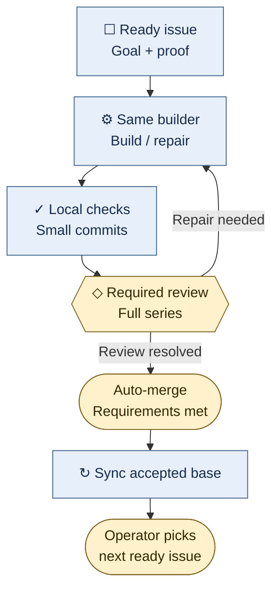
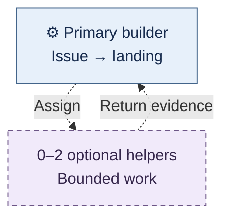
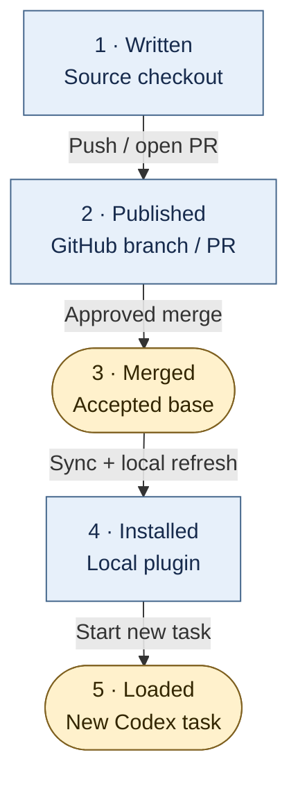

# OPL at a glance

**OPL helps you direct Codex from a defined problem to a checked, delivered change.**
You choose the work and its limits. A **builder** is the Codex conversation
responsible for implementing and repairing the change. Default work stays in
your selected checkout and branch, with small checked commits. New delivery
branches and PRs are opt-in. When you choose PR delivery, merge is automatic
after required checks and reviews, unless the project requires manual merge.

| Who | Responsibility |
| --- | --- |
| **You** | Set the goal, authorize actions, resolve choices and overrides. |
| **OPL** | Supply reusable skills, instructions, and workflow guidance. |
| **Codex** | Run the builder, tools, optional helpers, and review. |
| **GitHub** | Record issues, proposed changes, discussion, and delivery status. |

An **issue** describes work and how to tell it is complete. A **commit** saves a
named version of the code. A **pull request (PR)** proposes combining a series
of commits with the project's accepted code, called its **base**.

## Follow one issue through delivery

This map follows the **PR lane**, using the project's required checks and review.
Read downward. The return arrow means **the same builder repairs the work**.
Blue rectangles are work; amber shapes are review or delivery gates. Labels
and shapes carry the meaning even without color.

**Text route:** issue → builder → local checks and commits → review → same-builder
repair if needed → automatic merge → base sync → operator chooses next issue.

**Worked case:** an issue asks for a reliable file export. The builder implements
it, checks it locally, and opens a PR. Review finds that a failed write shows
“success.” The original builder repairs and checks that failure path; review
checks the repair. Merge follows automatically once required checks and review
are resolved, unless the project requires manual merge.
After base sync, the operator can select the next ready issue.

When work stops, fails, or changes

Local checks are the default. Hosted continuous integration (**CI**) adds useful
clean-environment or platform coverage when the project needs it. Review uses a
fixed starting version so earlier commits stay in scope; after repairs, recheck
the changed parts and evidence they invalidate.

Use independent review when the change's consequence, unresolved uncertainty,
or repository policy requires it. Routine self-inspection stays with the builder.

- A failed check returns to the builder. It is not a delivery checkpoint.
- A blocker stays visible on the owning issue, with the next safe action.
- After interruption, resume the builder's saved conversation and checkpoint
  where practical. A PR link alone does not identify that conversation.
- Closing a PR without merging does not complete its unresolved issue.
- A newly found distinct defect becomes an issue after deduplication and
  authorization checks. Recording it does not authorize starting it.
- Completion includes the issue's full acceptance scope. Merge alone does not
  prove a release, device behavior, or benefit to a person.

The [ongoing issue procedure](../plugins/opl/skills/github-workflow/SKILL.md)
owns status and recovery details. The project's instructions decide which
checks, review, and merge protections apply.

## Stop a repair loop before it becomes the project

At a meaningful boundary, keep a short agreement in the existing issue or checkpoint:
the outcome, why now, proposed mechanism, acceptance demonstration, aggregate budget,
and when to reconsider. Keep failed hypotheses and cumulative cost with that problem.

If two repair cycles fail to improve the same observable demonstration, or the agreed
budget is spent, stop dependent implementation. A structural contradiction can stop
it earlier. Compare a bounded repair, replacing the affected responsibility, and
revising an assumption. A new agent or issue does not buy two fresh attempts.
Conceptor projects reuse their existing assessment and checkpoint mechanism.
This working rule is not a universal runtime counter.

For example, a musical note arrives on time but never sounds. After two attempted
fixes fail on that same retained event, inspect whether audio scheduling, history
processing, or the measurement is responsible before changing another timer.
Keep the required musical behavior even if its current implementation must change.

The project entrance connects current evidence to the full route: resolve uncertainty,
prove one integrated experience, repeat it on the next intended case, complete the
agreed scope, qualify, and release. Historical passes retain their source and limits.
Use the entrance to **try** the product, **follow** one event through its owners, and
**change** it only within the selected work agreement and approval boundary.

## Choose how changes reach the base

The delivery map above shows the **opt-in PR lane**. Serial work is the default;
the project's policy can select another lane:

- **Serial direct commits:** one builder works in one conversation and makes
  checked commits directly to the agreed branch. No per-issue PR is required.
- **Parallel local integration:** independent builders use separate **worktrees**
  (working folders with their own checked-out branches). One integration owner
  combines their changes, checks the combined result, and lands them in order.
- **PR delivery:** a branch is published for review; the original builder owns
  repairs through merge and base sync. Automatic merge is the default after
  required checks and reviews; explicit manual-merge policy still applies.

**A worktree separates working copies. It does not require a PR.** Local lanes
still retain required checks, review, acceptance, and an explicit landing step.
Existing branch protections remain in force.

Native auto-merge waits for GitHub-required checks and reviews. The builder must
finish local requirements before an immediately available merge. Enabling
auto-merge does not wake the builder for review repairs or select the next issue.

## Count owners separately from helpers

Start with **one primary issue through landing per project**. Its primary builder
may use up to **two optional helpers** for bounded work. A helper supports that
owner; it does not automatically take another backlog issue.

**Text route:** one primary owns the issue; zero to two helpers report back.
Dashed lines and borders mean optional support, not another delivery stage.

Two independent primaries, if the project chooses that parallelism, can mean
**2 × (1 primary + 2 helpers) = 6 model threads**, plus separately launched review
sessions. The helper limit excludes the primary. Count extra sessions too.
Independent projects can run concurrently; this is no shared cross-project cap.

Set up a repository or inspect the actual limits

Parallel issue work needs satisfied dependencies, settled shared contracts, and
low conflict over files, services, or other resources. Someone still owns the
combined result. Spare capacity is permission to consider help, not a quota.

Ask Codex to use `$opl:setup-repo-workflow` when you want to configure a repository.
It inspects the existing instructions, checks, tracker, delivery lane, review,
merge policy, and resumption path.

The [native workflow reference](../plugins/opl/skills/setup-repo-workflow/references/native-workflow.md)
explains native settings and aggregate budgets. `$opl:configure-harness` inspects
the installed Codex capabilities and effective configuration. This guide adds
no configuration schema or scheduler limit.

## Know which copy changed

**Written → published → merged → installed → loaded by a new task.** Each step
needs another action. A checked source edit does not update your running Codex
session.

See which copy changes at each step

For an OPL change delivered through a PR:

**Text route:** source checkout → GitHub branch / PR → accepted base → local
plugin copy → new Codex task. [Installation and development](../README.md) cover the entry points;
[`$opl:refresh-local-plugins`](../plugins/opl/skills/refresh-local-plugins/SKILL.md)
owns the local refresh procedure.

**There is no unattended issue-to-delivery runtime installed by OPL setup.**
The operator selects eligible work and resumes the builder. The
[runtime research](runtime-research.md) records candidates and unresolved gaps;
[issue #4](https://github.com/OnePersonLabs/opl/issues/4) owns that separate scope.
A proposal or source implementation is not an active worker service.

If your reader cannot show these diagrams

Each map has a short text route immediately below it. These explain the same
ownership, order, and boundaries without Mermaid or color. The maps use
[Mermaid's accessible titles and descriptions](https://mermaid.js.org/config/accessibility.html).
No animation is needed.

GitHub renders Mermaid and the expandable details used here. Other Markdown
readers vary. The human-collaboration phone inbox does not render Mermaid or raw
HTML: use the existing [brief image-export and source-snapshot procedure](../plugins/opl/skills/human-collaboration/references/briefs.md)
for SVG/PNG/JPEG diagrams, and keep the equivalent text visible.

