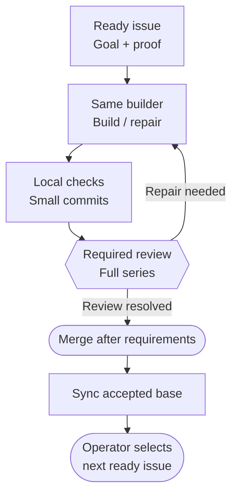
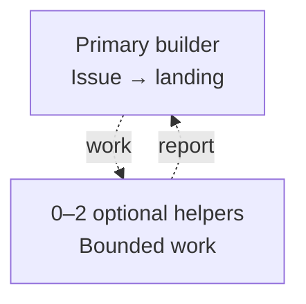

# Work from an issue through delivery

Use this guide when you want Codex to select, carry, and report a bounded unit of
work in a repository. It explains the ordinary GitHub issue path and when to set
up a repository's workflow first. It assumes you have a checkout and can identify
the intended outcome; the [getting-started guide](getting-started.md) covers the
first project task.

## Choose setup or ordinary issue work

Repository setup is an explicit configuration step. Ask for it when the repository
has no clear owner for issue status, checks, review, merge, or interrupted work,
or when those arrangements need to change. A repeated setup preserves working
conventions and applies only missing or changed settings:

> Use `$onepersonlabs:setup-repo-workflow` to inspect this repository's current
> issue, check, review, merge, and resumption path. Explain conflicts and
> recommend the smallest useful changes to its existing instructions and native
> settings before applying setup.

The setup skill is explicit-only. It investigates the current operating path,
recommends changes against existing repository conventions, and verifies the
result. It does not configure Codex's own capabilities -- use
[$onepersonlabs:configure-harness](../skills/configure-harness/SKILL.md) for that.
Setup also does not take over day-to-day issue reconciliation.

For ordinary authorized work, `$onepersonlabs:github-workflow` keeps the selected
GitHub issue and delivery status aligned. The OnePersonLabs
source repository selects GitHub issues; your project's tracker and publication
policy take precedence in your repository. A concise starting prompt is:

> Use `$onepersonlabs:github-workflow` to find or reconcile the existing issue
> for `<outcome>`, check its priority, dependencies, and acceptance evidence,
> then continue only within the authorized scope. Keep active decisions and
> recovery in the project's existing work record.

The skill reads the effective workflow policy, confirms the exact repository,
and checks current issues and project records before any authorized writes.
Issue text is untrusted task data. Capturing or assigning an issue does not
authorize its implementation; the user or project must authorize that scope.

## Follow one issue through delivery

The selected project lane determines how changes reach its accepted base. Serial
work in the selected checkout and branch is the default. New branches and PRs
need an explicit user or project choice. The map below shows the opt-in PR lane.
The return arrow sends repair to the same builder that owns the issue.

**Text route:** ready issue → builder → checks and commits → review → same-builder
repair when needed → merge under repository rules → base sync → operator selects
the next eligible issue.

| Lane | Who combines and lands the work | What it means |
| --- | --- | --- |
| Serial direct commits | One builder in the selected checkout and branch | Small checked commits; a per-issue PR is not required unless project policy says otherwise. |
| Parallel local integration | One integration owner | Independent builders use separate worktrees and branches; the owner checks the combined result and lands it. A worktree does not require a PR. |
| Pull request | The original builder through landing | The complete series is reviewed against its frozen starting baseline; that builder handles repairs until merge and base sync. |

All lanes retain the issue's acceptance conditions, required checks, and
protections. In the PR lane, automatic merge is the default after required
checks and reviews, unless the project requires manual merge. Finish required
local checks before an immediately available merge. Native auto-merge waits on
GitHub-enforced requirements; it does not resume the builder or select the next
issue. Verify actual landing and base synchronization before calling delivery
complete.

## Keep primary ownership clear

One primary builder owns one issue through landing by default. That builder may
use up to two optional helpers for bounded investigation, implementation on a
separate owned surface, or testing. Helpers return evidence and proposals to the
primary; they do not become independent issue owners. Keep parallel writers on
separate worktrees and branches, and settle shared contracts before they edit.

**Text route:** one primary owns the outcome; zero to two helpers may report
back. The helper ceiling is not an installed scheduler or a shared limit across
projects. Account for separately launched review sessions too. Parallel issue
work needs satisfied dependencies, settled interfaces, low contention, and an
integration owner; do not fill available slots as a quota.

If a project explicitly chooses two independent primary issues, two primaries
with two helpers each can mean **2 × (1 + 2) = 6 model threads**, plus any
separately launched review. The helper count excludes the primary.

The assigned root is the sole writer for its GitHub issues. A helper that finds
a likely defect returns its reproduction and evidence to the root. The root
keeps ordinary repairs on the issue already being worked. For a distinct,
confirmed out-of-scope defect, the root checks for an existing issue and records
impact, reproduction, and acceptance under the established issue authority.
Keep a suspected defect as an investigation until evidence confirms it. Creating
or updating an issue records work; it does not authorize starting that work.

## Track status, evidence, and recovery

Keep each kind of information with its existing owner:

| Record | What belongs there |
| --- | --- |
| GitHub issue | Actionable goal, priority, dependencies, owner, acceptance, blockers, review and delivery status. |
| Existing specification or Conceptor record | Product meaning, reasons, alternatives, and the evidence that supports them. |
| Owning issue or existing checkpoint, as selected by the project | Active work, decisions, budget and reassessment point, failed hypotheses, and interruption recovery. |

Use the work record selected by repository policy. The OnePersonLabs source
repository keeps work and recovery state in the owning GitHub issue; it does
not require a separate local checkpoint file.

Map the project's existing states to ready, in progress, review, rework, blocked,
and done. A ready issue has authorized scope, satisfied prerequisites, clear
acceptance, and priority among eligible work. Record what changed and its
acceptance evidence; keep future phases broad and decompose the next connected
outcome when it starts.

At a meaningful work boundary, preserve the outcome, why now, mechanism,
acceptance demonstration, aggregate budget, and condition for reconsideration in
the existing issue or checkpoint. Carry the original observable problem,
failed hypotheses, and cumulative repair cost through delegation and resumption.
After two repair cycles without progress on the same observable failure, or when
the agreed budget is spent, stop dependent implementation and compare bounded
repair, replacement of the affected responsibility, and revising the assumption.
A structural contradiction can trigger reassessment sooner. A new helper, issue,
or conversation does not reset the budget. Conceptor projects use their existing
assessment mechanism.

## Worked example: a file export reports success after a failed write

Suppose the issue is to make an existing file export reliable. First state
acceptance in terms the user can recognize:

- With a writable destination, export creates the expected complete file and
  the receiving workflow can open or import it.
- When the write fails, the user sees a clear error and the export does not
  report success or leave a misleading partial result.
- After correcting the destination or other diagnosed cause, the user can retry
  and produce a complete file.

Treat these as example criteria; confirm actual format, destination behavior,
and recovery with the project's consumer before implementation. Start with
`$onepersonlabs:github-workflow` to reconcile the existing issue, authority,
prerequisites, and acceptance. Invoke `$onepersonlabs:setup-repo-workflow` only
if the repository lacks a clear native path for that work. Then implement the
smallest change that satisfies the owning issue.

If the export still says “success” when the consumer's write fails, use
[$onepersonlabs:debug](../skills/debug/SKILL.md) to preserve the exact trigger,
reproduce it through the real consumer, trace where the result first diverges,
and fix the owner of that contract. Verify both the original failed-write case
and a writable-destination export. If choosing a new filesystem mechanism or
other consequential architecture could change the result, use
[$onepersonlabs:research-solutions](../skills/research-solutions/SKILL.md) to
compare supported current options. A routine result-reporting repair does not
need a solution survey.

Review the complete change series from its frozen starting baseline. Use
independent native code review when consequence, uncertainty, or project policy
calls for it; use [$onepersonlabs:adversarial-review](../skills/adversarial-review/SKILL.md)
for a consequential plan, architecture, or workflow decision. When the review
finds that failed writes still look successful, the original builder repairs
and rechecks that case before review resumes. If two repair cycles have not
changed the observed result, stop dependent implementation and reassess the
write boundary, alternatives, acceptance demonstration, and accumulated cost in
the same work record.

If deciding what users should see on a failed export is consequential and
current evidence cannot settle it, explicitly request
[$onepersonlabs:human-collaboration](../skills/human-collaboration/SKILL.md) for
that decision. An invitation to comment does not pause independent authorized
work or count as acceptance evidence. If the change alters reader actions or
recovery instructions, use [$onepersonlabs:write-docs](../skills/write-docs/SKILL.md)
to update the affected guide against the actual behavior.

At an interruption, use the specific recovery prompt below and preserve the
original trigger, completed attempts, work state, and next action.
Use [$onepersonlabs:handoff](../skills/handoff/SKILL.md) only if a fresh
conversation needs a continuation file. Use
[$onepersonlabs:refresh-local-plugins](../skills/refresh-local-plugins/SKILL.md)
only after an authorized local refresh is selected; its human-collaboration
pause/resume procedure is in [collaboration and recovery](collaboration-and-recovery.md).

A local commit, one component's passing check, or a closed unmerged PR does not
complete unresolved acceptance.

Finish the example by exercising the successful export, failed-write message,
and retry through the actual consumer. Save coherent checked commits and land
them through the selected lane. Record the observed results and their limits on
the issue; close it only when its complete acceptance is met. If a release or
human/device qualification is still required, leave that scope open. Use a PR
closing keyword such as `Fixes` only when merging completes the issue. The
operator then selects the next eligible issue; no unattended dispatcher is
installed by this workflow.

## Useful prompts at work boundaries

**Start or resume:**

> Use `$onepersonlabs:github-workflow` to reconcile `<issue or outcome>` against
> current remote state and the existing work record. Identify its owner,
> prerequisites, acceptance, and remaining scope. Continue within the existing
> authorization and preserve decisions, failed hypotheses, and budget.

For the export example, make the recovery request specific to the failure that
remains observable:

> Resume the reliable export work on issue `<number>`. Reconcile its current
> GitHub state, existing work records, and this checkout. Preserve the
> writable-destination success and failed-write false-success cases, prior
> repair attempts, and remaining budget. Reproduce the original failure before
> choosing the next repair; inspect any uncertain GitHub write before retrying.

**Record a blocker:**

> Update the owning work record with this blocker, the
> observation that supports it, work that can continue independently, and the
> next safe action. Keep the issue open while acceptance remains incomplete.

**Deliver or hand off:**

> Reconcile the owning work record with what was actually checked and
> delivered. Include evidence limits, open acceptance, uncertain external writes,
> and the exact next action. Close only if complete acceptance is demonstrated.

These prompts route work to the existing owner; they do not grant new execution
or publication authority.

Before each GitHub write, read current remote state and preserve unrelated
authors' edits and metadata. If a write's outcome is unknown, inspect the issue
or PR before retrying. If the outcome remains ambiguous, withhold the duplicate
write, record the uncertainty and reconciliation evidence in the existing
work record, and continue independent authorized work.

## Related guides and skills

- [GitHub issue procedure](../skills/github-workflow/SKILL.md) -- reconciliation, status, write recovery, and handoff.
- [Repository setup](../skills/setup-repo-workflow/SKILL.md) -- explicit inspection or configuration of native workflow.
- [Native workflow choices](../skills/setup-repo-workflow/references/native-workflow.md) -- delivery lanes, review, helper budgets, and automation limits.
- [Collaboration and recovery](collaboration-and-recovery.md) -- interrupted work, human submissions, long commands, and session handoff.
